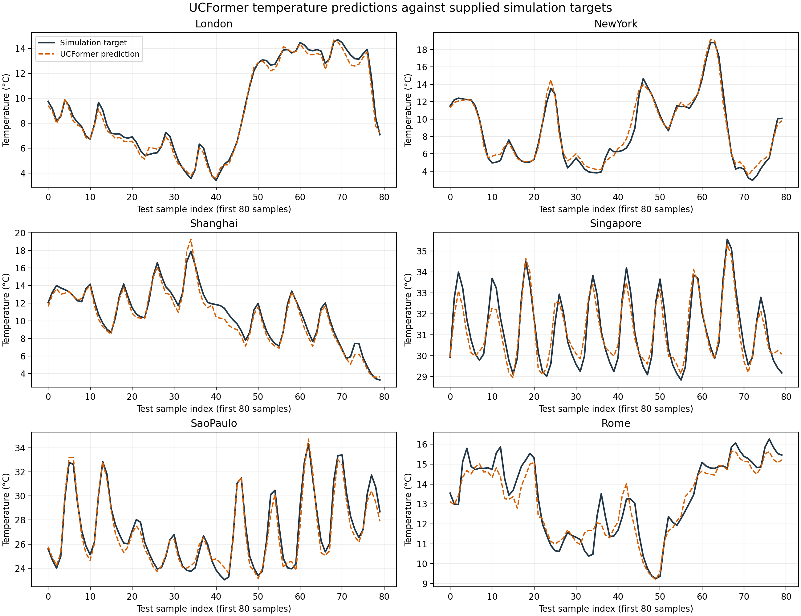
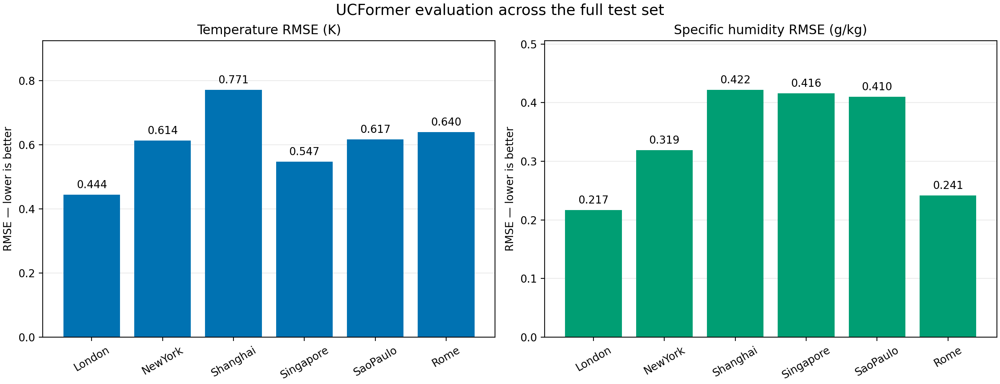

# UCFormer implementation verification

## Purpose
Run the parent paper's implementation using its supplied six-city dataset.
This experiment does not use Houston-specific project data.

## Parent paper
Learning Urban Climate Dynamics via Physics-Guided Urban Surface–Atmosphere Interactions (NeurIPS 2025).

Paper: https://openreview.net/forum?id=i9BjNoVjub
Original code: https://github.com/envdes/code_UCformer
Dataset: https://huggingface.co/datasets/XiGuaaa/ucformer_dataset

The original authors developed UCFormer. Local work includes compatibility
adjustments, checkpoint evaluation, CSV exports, and a separate plotting script.

## Environment
- Windows with Conda environment: ucformer
- PyTorch: 2.7.1+cu128
- GPU: NVIDIA GeForce RTX 3050 Ti Laptop GPU

## Experiment settings
- Training data: 2020-2044
- Validation data: 2045-2049
- Test data: 2050-2054
- Training script configured for 5 epochs
- Evaluated checkpoint: epoch 4
- Best validation loss: 0.001190254808884097
- Batch size: 64
- Learning rate: 0.00001
- Training seed: 41
- Checkpoint selection: minimum validation loss

Validation loss is the sum of three MSE losses on normalized targets.

## Commands
Run from Parent_Paper_1 with the ucformer environment active.

Evaluate an existing checkpoint:
    python main/inference.py --datapath "C:/Users/micha/ucformer_data/"

Plot this saved evaluation:
    python scripts/plot_results.py --results "results/evaluation_20261108_151557"

Train a new model:
    python main/train.py --datapath "C:/Users/micha/ucformer_data/"

Training can overwrite checkpoints/UCformer.pth. Preserve existing weights first.
Inference requires a compatible checkpoint at checkpoints/UCformer.pth.
The dataset path must end with a slash.

## Results
Evaluation date: November 8, 2026.

| City | Temperature RMSE (K) | Specific humidity RMSE (g/kg) |
|---|---:|---:|
| London | 0.4444 | 0.2169 |
| New York | 0.6137 | 0.3188 |
| Shanghai | 0.7713 | 0.4216 |
| Singapore | 0.5475 | 0.4159 |
| Sao Paulo | 0.6168 | 0.4100 |
| Rome | 0.6398 | 0.2414 |
| Unweighted city mean | 0.6056 | 0.3375 |

Mean temperature R2: 0.9775.
Mean specific humidity R2: 0.9861.
Reported combined MESS: 1.1662.

Combined MESS sums the three target-specific city-average scores.
It is not a percentage.

## Figures

The line plots show the first 80 test samples per city.

The RMSE plots use the full test set.

## Verification and limitations
- Inference completed for all six cities.
- Test features and labels each contain 219000 rows and no missing values.
- City grouping was checked against longitude and latitude.
- Atmospheric reference temperature, humidity, and pressure exactly match
  the corresponding test feature rows.
- Targets are supplied simulation outputs, not observed weather.
- Dew_Point values require clarification of their physical interpretation.
  They remain unchanged for this implementation verification.
- Training and evaluation use slightly different standard-deviation
  conventions in the supplied preprocessing; this was preserved.
- A matched comparison with the paper's reported experiments remains pending.
  These results demonstrate execution, not full reproduction of published performance.
