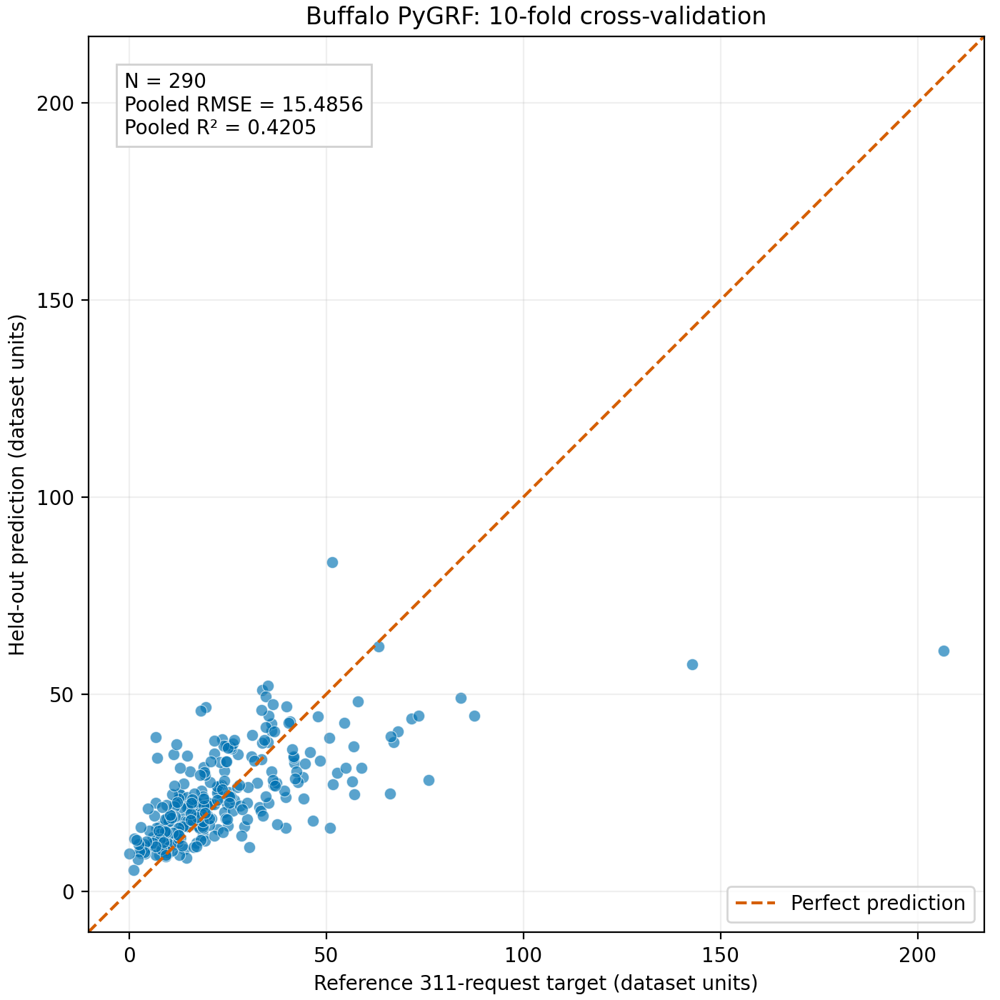
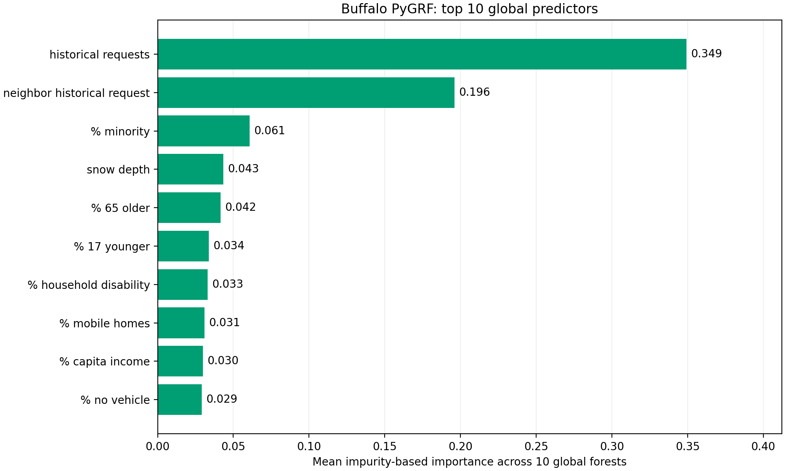

# PyGRF Buffalo implementation verification

## Sources
Paper: PyGRF: An improved Python Geographical Random Forest model and case studies in public health and natural disasters.
Authors: Kai Sun, Ryan Zhenqi Zhou, Jiyeon Kim, and Yingjie Hu (2024).
Original code: https://github.com/geoai-lab/PyGRF
Paper: https://www.acsu.buffalo.edu/~yhu42/papers/2024_TGIS_PyGRF.pdf

The original source, datasets, and notebooks are provided by the authors.
Local additions are run_buffalo_reproduction.py, plot_buffalo_results.py,
and the exported evaluation results.

## Experiment
- Supplied Buffalo dataset: 290 rows, 18 predictors.
- Target: supplied 311_requests column, retained in dataset units.
- Evaluation: shuffled 10-fold cross-validation, random_state=42.
- Standardization uses each fold's training statistics.
- Model: 60 trees, max_features=1/3, bandwidth=131.
- Local prediction weight: 0.0444.
- Weighted training/prediction and resampling enabled; bootstrap disabled.
- Fixed notebook parameters reused; hyperparameter search was not rerun.

## Results

| Metric | Published improved PyGRF | Local run |
|---|---:|---:|
| RMSE | 15.4854 | 15.4856 |
| R2 | 0.4205 | 0.4205 |

Local metrics are calculated across all pooled held-out predictions.
The selected Buffalo experiment is closely reproduced numerically.
Measured workflow runtime: 159.1 seconds; this is not hyperparameter tuning time.

## Run instructions
Use a separate Python 3.10 environment.
Install dependencies using requirements-reproduction.txt.

From this directory:
    python -u run_buffalo_reproduction.py

Plot the saved run:
    python plot_buffalo_results.py --results results/buffalo_20261108_162916

Each evaluation creates a new timestamped results directory.
Exact package versions and settings for the recorded run are in run_settings.json.

## Figures

## Interpretation and limitations
- Predictions substantially underestimate the largest target values.
- Historical requests and neighboring historical requests account for
  approximately 54.5% of the global importance scores.
- Importance scores are impurity-based averages across global forests;
  they do not establish causation or describe local importance.
- Random cross-validation within this dataset does not establish
  generalization to new storms or regions.
- This experiment uses the supplied Buffalo data, not Houston project data.
